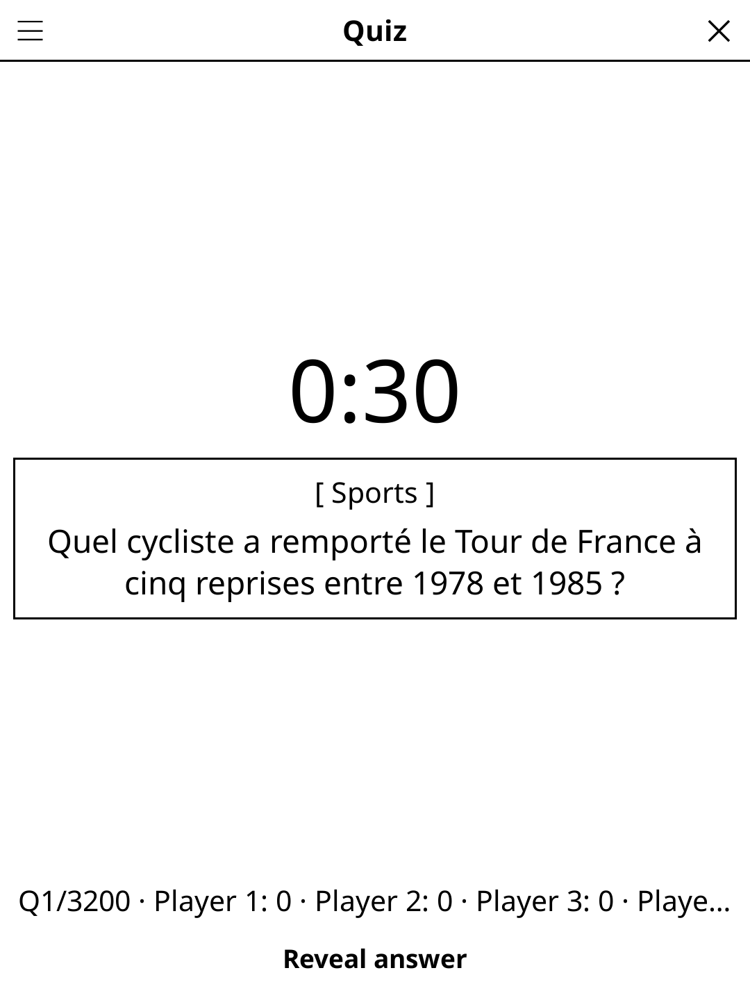

# quiz.koplugin

A **Quiz** display plugin for [KOReader](https://github.com/koreader/koreader) — general knowledge quiz for a crowd, no app required.

## Screenshot



## Concept

Everyone grabs a sheet of paper. The question appears on screen, the timer ticks. Everyone writes their answer. When time runs out (or the host taps *Reveal*), the answer appears. The host reads answers aloud and taps the score button for each correct player.

The plugin ships with **3,200 French questions** and **1,602 English questions**, each in 32 categories, built in — no setup required. The question language follows KOReader's interface language and can be changed from the menu (*Language*). You can also drop your own JSON file into KOReader's documents folder to replace the bundled questions.

## Rules

- The question is displayed; everyone writes their answer on paper before time runs out.
- The host taps **Reveal** to show the answer, then awards **+1** to each correct player.
- Questions are shuffled and wrap around automatically.
- First player to reach the agreed score wins (or play all questions and compare totals).

## Features

- **Question + answer in two phases** — question visible during writing time, answer revealed on demand
- **Optional countdown timer** — 20 s / 30 s / 45 s / 1 min, or disabled for self-paced play
- **Per-player score buttons** — tap a player's button to give them +1 after each reveal
- **Category badge** — displayed above the question when provided
- **Category picker** — enable/disable individual categories from Options (multi-select, per language)
- **Question counter** — shows current position in the deck (e.g. *3 / 42*)
- **2–8 players** — configurable player count
- **French and English question banks** — 3,200 FR and 1,602 EN questions bundled; only the bank for the language in play is loaded
- **FR + EN UI**
- **Reload** — refresh the question file without restarting
- **E-ink friendly** — only the timer digit refreshes in fast/A2 mode

## Bringing your own questions

To replace the bundled questions with your own set, create a file named
`quiz_questions_fr.json` (or `quiz_questions_en.json`, or `quiz_questions.json`) and copy it to
KOReader's **documents** folder (`/sdcard/koreader/` on most devices). A file placed there takes
priority over the bundled deck, in this order: `quiz_questions_<lang>.lua` (same format as the
bundled banks), `quiz_questions_<lang>.json`, then `quiz_questions.json` (used for any language).

```json
[
  {
    "question": "Quelle est la capitale de l'Australie ?",
    "answer": "Canberra",
    "category": "Géographie"
  },
  {
    "question": "En quelle année a eu lieu la Révolution française ?",
    "answer": "1789",
    "category": "Histoire"
  }
]
```

Each question object must have:
- `"question"` — the question text
- `"answer"` — the revealed answer
- `"category"` *(optional)* — shown as a badge above the question

Questions are shuffled on load and wrap around automatically.

## Controls

| Button | Action |
|--------|--------|
| **Révéler la réponse / Reveal answer** | Stop timer and show answer + score buttons |
| **+Player (score)** | Award +1 to that player |
| **Question suivante / Next question** | Advance to next question + restart timer |
| **Options** | Language, categories, players, timer, reset, reload file |
| **Rules** | Show rules + JSON format reminder |
| **Close** | Exit |

## Installation

### Via KOReader Plugin Manager

```
quiz.koplugin/ → KOReader plugins/ folder
game-common/    → alongside plugins/ (shared library)
```

### Manual

1. Download `quiz.zip` from [Releases](../../releases).
2. Extract to your KOReader `plugins/` directory.
3. Restart KOReader — **Quiz** appears under Tools → Games → Party & quiz, ready to play with the bundled English or French questions.
4. Optionally copy your own `quiz_questions_fr.json` (or `quiz_questions_en.json`) to KOReader's documents folder to replace the bundled questions.

## Development

`quiz.koplugin/` lives inside the
[koreader-plugins](https://github.com/t2ym5u/koreader-plugins) monorepo.

`quiz_questions_fr.lua` and `quiz_questions_en.lua` are the bundled question
banks. They are generated — do not edit them by hand, the next build would
overwrite the change. They are built from the per-category files in
`questions/` (`quiz_questions_fr_*.json`, `quiz_questions_en_*.json`) by
`gen/to_lua.py`. Regenerate them after editing any of those files:

```
python3 gen/to_lua.py        # both languages
python3 gen/to_lua.py en     # one language
```

Each question has `question`, `answer`, `category` and `difficulty`
(`facile`/`moyen`/`difficile` in French, `easy`/`medium`/`hard` in English).
The English bank was written for English speakers, not translated: answers
are short enough for a table to judge, accepted variants go in brackets
(`Beetroot (beet)`), and only stable facts are used — no records,
office holders, populations or anything "current".

`quiz_bank.lua` decides where questions come from (documents folder first,
then the bundled bank). Run the specs with `busted test_questions_spec.lua`.

## License

GPL-3.0
